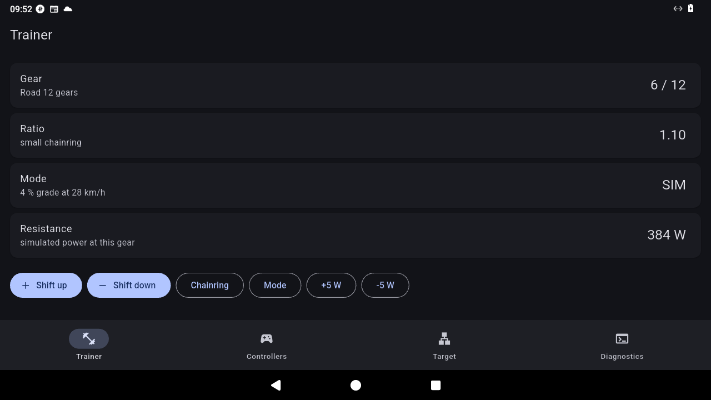
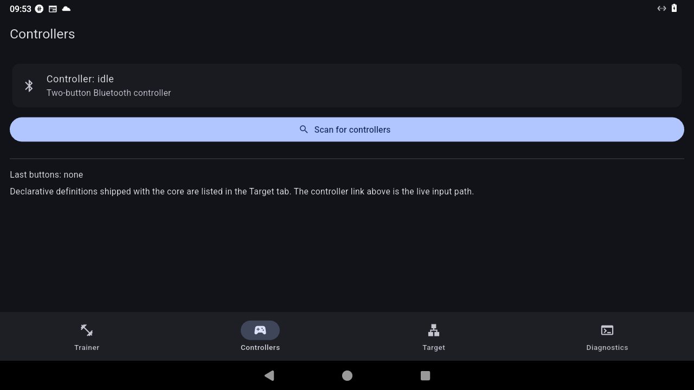
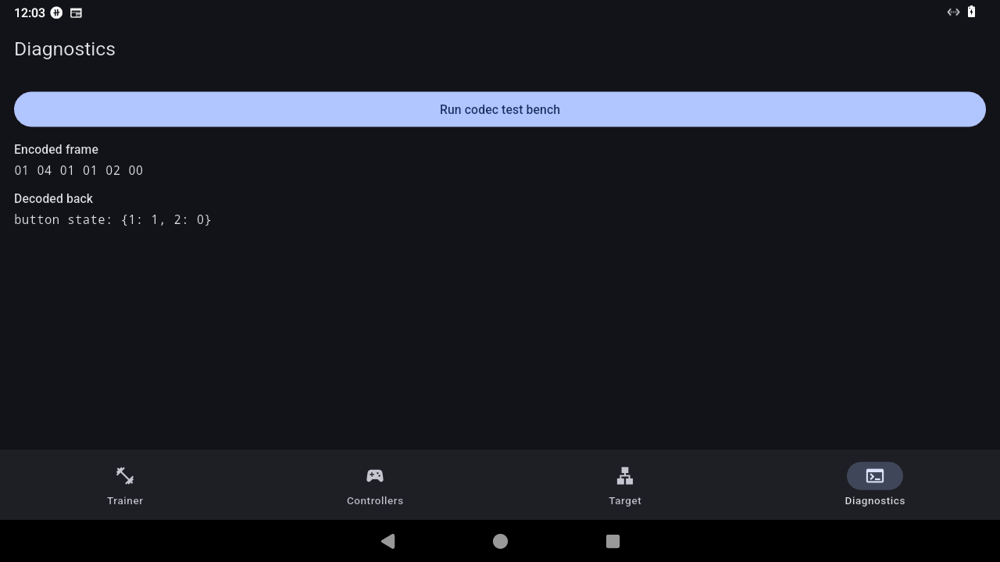
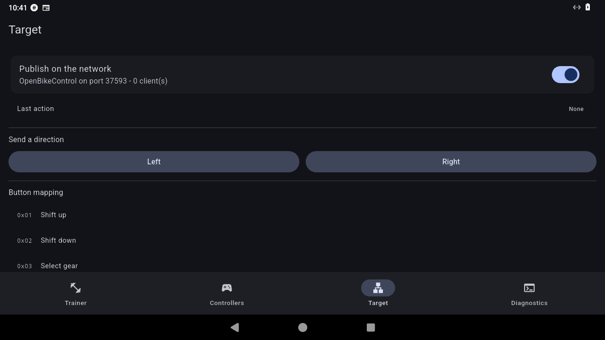

<div align="center">

# openzclick

**Use your indoor cycling controller buttons with any training app.**<br>
Gears go up and down, intersection directions get chosen, the smart trainer follows.

[](https://github.com/Atlanwhite147/openzclick/actions/workflows/ci.yml)
[](https://github.com/Atlanwhite147/openzclick/actions/workflows/android.yml)
[](https://github.com/Atlanwhite147/openzclick/actions/workflows/ios.yml)
[](LICENSE)
[](#download)
[](#status)

</div>

---

A two-button controller bought for one application usually stops working as soon as you change application. openzclick reads the controller over Bluetooth, turns its button presses into gear changes, and publishes them on the local network with an open protocol, so the same buttons drive every training application that speaks it.

No account, no subscription, no telemetry. One Dart codebase for Android, iOS, Windows and macOS.

<div align="center">

| Trainer | Controllers | Direction | Publishing |
|---|---|---|---|
|  |  |  |  |

</div>

## Features

| | |
|---|---|
| **Gears from two buttons** | single tap shifts up or down, from a gear profile (12-speed road, 8-speed flat, 24-speed hill) |
| **Intersection choices** | double tap sends a left or right direction without leaving the hoods |
| **Encrypted controller sessions** | ECDH P-256 handshake, HKDF-SHA256 derivation, AES-CCM frames, with a plain fallback for older firmware |
| **Open publication** | mDNS/DNS-SD announcement plus a TCP server, both in pure Dart, identical on every platform |
| **Works without hardware** | the whole protocol is unit tested; a command line probe checks the network link |
| **Honest diagnostics** | live controller state, battery level, codec test bench inside the application |

## Download

| Platform | File | Notes |
|---|---|---|
| Android | [`app-release.apk`](https://github.com/Atlanwhite147/openzclick/releases/download/latest/app-release.apk) | sideload directly, updates install over the previous version |
| iOS | [`openzclick-unsigned.ipa`](https://github.com/Atlanwhite147/openzclick/releases/download/latest/openzclick-unsigned.ipa) | sign with Sideloadly or AltStore, 7 days with a free Apple ID |

Both files are rebuilt on every push to `main`. The Android package is signed with the repository community key (`app/android/keystore/openzclick-test.jks`, password `openzclick`), which is public by design and must never be used for a store release.

## Getting started

```bash
git clone https://github.com/Atlanwhite147/openzclick.git
cd openzclick

# protocol and transports
cd core && dart pub get && dart test
cd ../transports && dart pub get && dart test

# application
cd ../app && flutter pub get
flutter run -d linux      # or windows, macos, android, ios
```

Requirements: Flutter stable (Dart 3.13 or newer). No Android SDK or Xcode needed for the protocol work.

## Architecture

```
openzclick/
├─ core/          # pure Dart, no I/O: codec, session, gear engine, mapping, gestures
├─ transports/    # dart:io: mDNS responder, TCP server, Bluetooth/injection/proxy interfaces
├─ app/           # Flutter shell: pairing, gears, publishing, diagnostics
├─ docs/          # specification, architecture notes, screenshots
└─ CONTRACTS.md   # interface signatures between the modules
```

Three rules keep the code portable:

1. **The core never performs I/O.** Everything can be tested without Bluetooth or a network.
2. **One output, one transport.** Implementations are wired at runtime, never selected by platform conditionals.
3. **No brand logic in the core.** Devices are described by declarative definition files.

## How the link works

**Controller side.** Scan for the controller service (`00000001-19ca-4651-86e5-fa29dcdd09d1`), subscribe to its synchronous channel, send an encrypted handshake carrying an ephemeral P-256 key with a plain `RideOn` fallback after three seconds. If the device answers with its public key, the session is derived with ECDH then HKDF-SHA256 and every frame is decrypted with AES-CCM; otherwise frames are parsed in the clear. Button notifications are protobuf varints.

**Training application side.** The application announces `openzclick._openbikecontrol._tcp.local` with its port, version, role and button list. A client connects over TCP, sends an application info frame, and receives one frame per action: `01 02 01 01` for shift up pressed, `01 02 18 01` for a left direction.

Check the publication without a phone:

```bash
cd transports && dart run tool/net_probe.dart 47123
```

Then browse `_openbikecontrol._tcp` with any mDNS browser and connect a client to the printed port.

Protocol facts are implemented in Dart from public interoperability notes; no third-party code is copied. Cryptographic primitives come from `pointycastle`.

## Status

| Module | State | Tests |
|---|---|---|
| `core/` | protocol, session, gear engine, mapping, gestures | 217 |
| `transports/` | mDNS responder, TCP server; Bluetooth, injection and proxy are interfaces | 71 |
| `app/` | pairing, gears, publishing, diagnostics on the four platforms | 6 |

Verified on Android 13: installation, first frame, gear changes, direction choices, announcement visible from the local network and TCP handshake with a client. The Bluetooth link cannot be exercised in the test container, which has no radio; see [CONTRIBUTING.md](CONTRIBUTING.md) if you own a controller and want to help close that gap.

## Roadmap

- [x] binary protocol, encrypted sessions, gear engine
- [x] two-button gestures, direction choices
- [x] network publication in the shared core
- [x] continuous Android and iOS builds
- [ ] local injection transport for applications that only accept a keyboard
- [ ] Bluetooth peripheral backend (advertise the bridge as a trainer)
- [ ] iPhone multicast entitlement

The full specification lives in [docs/spec.md](docs/spec.md).

## Contributing

Issues and pull requests are welcome. Read [CONTRIBUTING.md](CONTRIBUTING.md) first: it explains the module boundaries, the test expectations and how to report a controller that does not pair.

## License

MIT, see [LICENSE](LICENSE).
