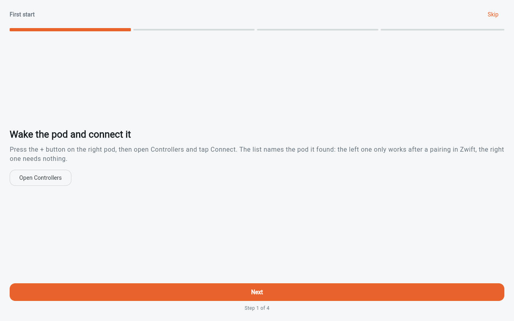
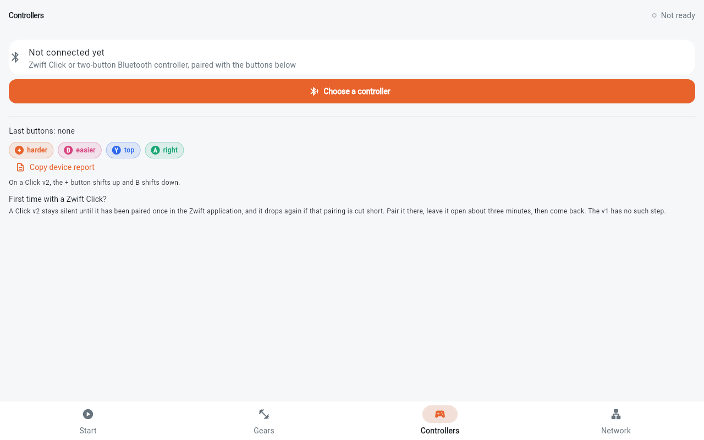
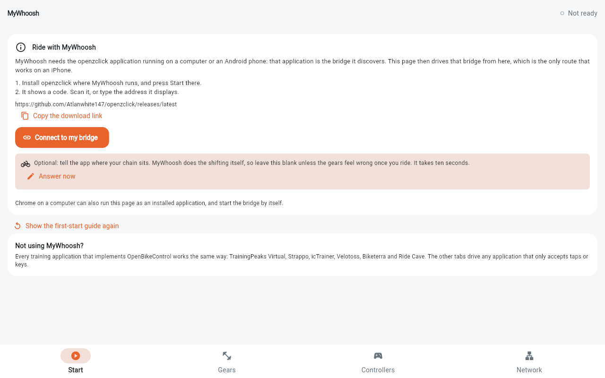

# openzclick

**Use your indoor cycling controller buttons with MyWhoosh.**

openzclick lets the buttons on your handlebar controller change gear in
MyWhoosh. It works on a Windows PC today.
Download one file, `openzclick-setup.exe`, and you are done.

openzclick runs on the same PC as MyWhoosh. It listens to your controller over
Bluetooth and tells MyWhoosh when you press a button. No account, no
subscription, no cable, no driver.

## Windows, the easy way

This is the one path tested on real hardware. Follow it in order.

1. **Download `openzclick-setup.exe`** from the
   [releases page](https://github.com/Atlanwhite147/openzclick/releases/latest)
   and double click it. If Windows says *Windows protected your PC*, press
   **More info**, then **Run anyway**. No administrator password to type.
2. **Open openzclick** from the Start menu and press the green **Start**
   button. The window says it is waiting for MyWhoosh.
3. **In MyWhoosh**, go to the device connection screen before you start a ride.
   Tap the round OpenBikeControl icon in the top right corner, then answer
   **Yes**. The icon turns blue.
4. **In openzclick**, open the **Controllers** tab and press **Scan**. Press a
   button on your controller so it wakes up, and select its name when it
   appears. Then ride: your buttons change gear.

Two signs the link is up: the icon in MyWhoosh is blue, and the client count in
openzclick reads 1. The **Gears** tab checks the link without pedalling.

## Other platforms

Windows is the only easy path today. The rest exist but ask more of you.

| Platform | How hard |
|---|---|
| Windows | easy |
| macOS | a few clicks: the app is not signed, so you allow it once, and give Bluetooth permission again after each update |
| Android | a few clicks: install the APK, then accept *install from this source* |
| iOS | not for you yet: needs a computer and signing that expires after seven days |

Files for all of them, and what each one does, are on the
[releases page](https://github.com/Atlanwhite147/openzclick/releases/latest).

## If it does not work

| What you see | What to do |
|---|---|
| MyWhoosh does not see openzclick | Both must be on the same Wi-Fi network, on Windows. Wi-Fi on the PC and Wi-Fi on the router, not a mobile hotspot. |
| Windows asks about a firewall | Allow openzclick on private networks. Without it, MyWhoosh cannot reach it. |
| MyWhoosh says connected, but the buttons do nothing | The controller is not paired. Open **Controllers**, press **Scan**, and press a button on the controller so it wakes up. *Nothing answered* means it was asleep. |
| It disconnects after a minute | Some controllers need one first pairing inside the Zwift app: open Zwift, leave it about three minutes, then come back. |
| The gear changes in openzclick but not in MyWhoosh | MyWhoosh has taken the trainer for itself. Let MyWhoosh own the trainer, not openzclick. |

Something else? Open **Controllers**, press **Copy device report**, and send it
with your question: it carries what is needed to help you.

| First start | Gears | Controllers | Start |
|---|---|---|---|
|  |  |  |  |

## What is missing

The iPhone version has not been tried with a real controller.
The left pod of a pair has only been tested on the right one.
Becoming the trainer itself is not written yet.

## Learn more

[docs/](docs/) has the details this page keeps short: platform support,
architecture, the protocol, and how to contribute.

## License

MIT, see [LICENSE](LICENSE).
