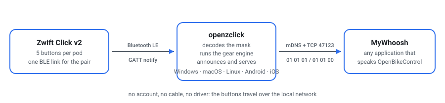
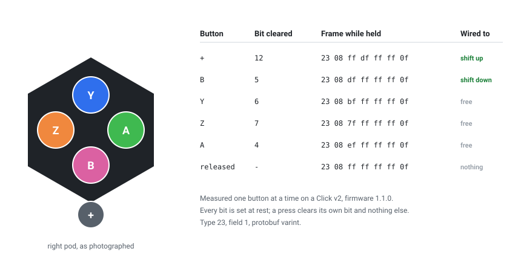
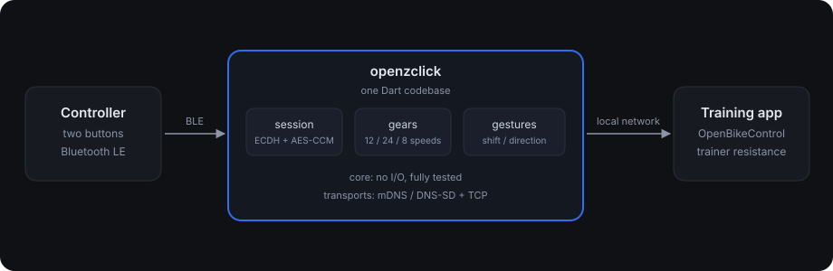
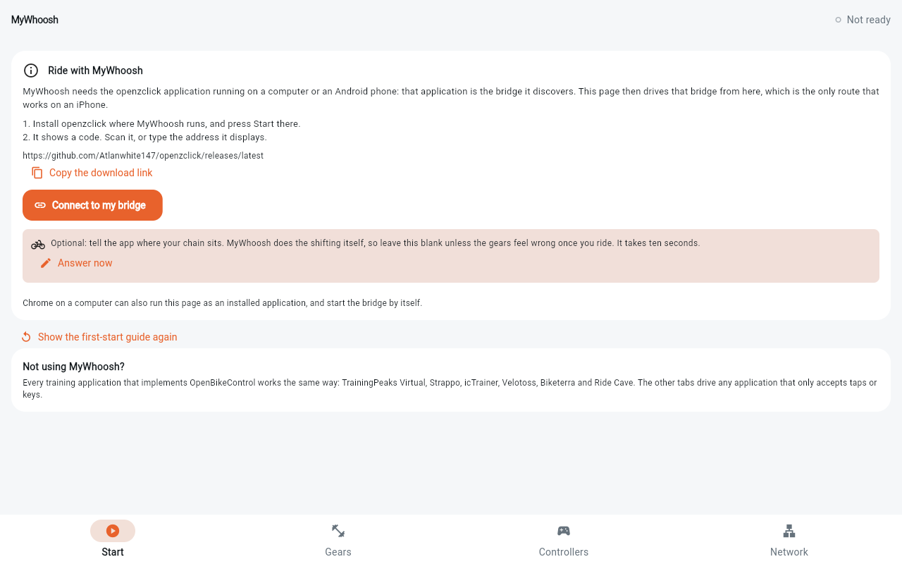
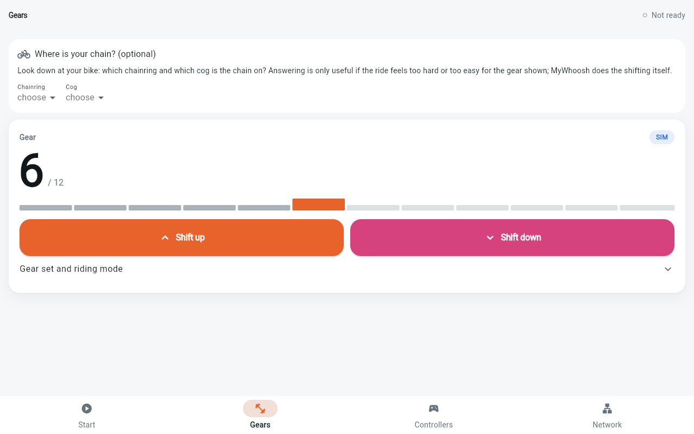
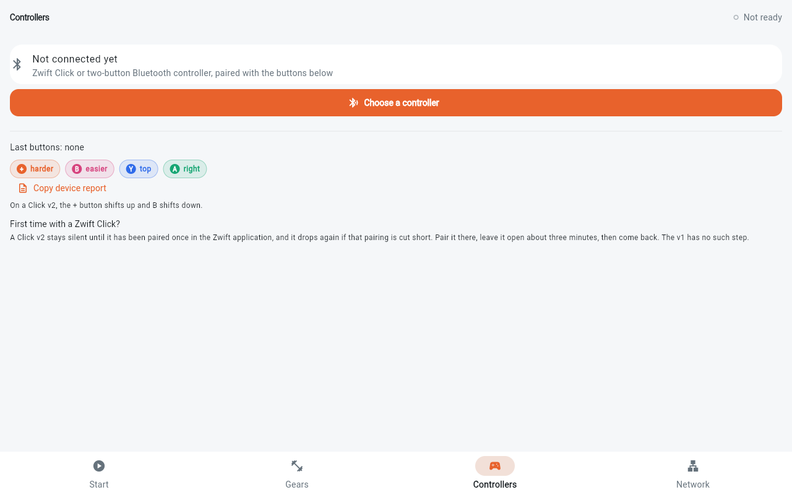
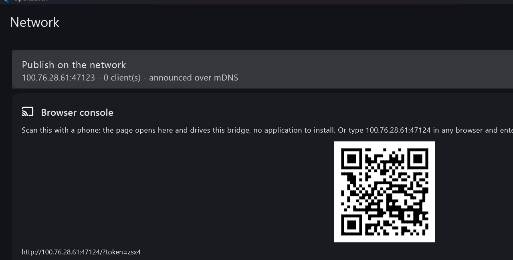

<div align="center">

# openzclick

**Use your indoor cycling controller buttons with any training app.**<br>
Gears go up and down, intersection directions get chosen, the smart trainer follows.

[](https://github.com/Atlanwhite147/openzclick/actions/workflows/ci.yml)
[](https://github.com/Atlanwhite147/openzclick/actions/workflows/android.yml)
[](https://github.com/Atlanwhite147/openzclick/actions/workflows/ios.yml)
[](https://github.com/Atlanwhite147/openzclick/actions/workflows/windows.yml)
[](https://github.com/Atlanwhite147/openzclick/actions/workflows/web.yml)
[](LICENSE)
[](#status)

</div>



A controller bought for one application usually stops working as soon as you change application. openzclick reads it over Bluetooth, turns button presses into gear changes, and publishes them on the local network with an open protocol, so the same buttons drive every application that speaks it.

**No account, no subscription, no cable, no driver, no telemetry.** One Dart codebase for Android, iOS, Windows, macOS and the browser.

## Measured on real hardware

Everything below was captured from a Click v2 (firmware `1.1.0`) over WinRT and is asserted by a test:



<details>
<summary><b>The three things that cost an evening each</b></summary>

<br>

1. **A UUID is one identifier written three ways.** Windows reports Bluetooth SIG services short: the vendor service comes back as `fc82` where the specification says `0000fc82-0000-1000-8000-00805f9b34fb`. Compare the canonical form, never the raw strings, or the service is present and never found.
2. **A connection is not a service table.** The first discovery right after a connection can return without the vendor service. Retry it before concluding that a channel is missing.
3. **An echo is not an answer.** The encrypted handshake is answered either with the device public key or with a bare `RideOn` echo and then silence. A Click v2 does the second, and the plain handshake has to go out anyway, because that is what makes it stream its buttons. The decision rests on the derived session, not on having received bytes.

The controller report lives in [#3](https://github.com/Atlanwhite147/openzclick/issues/3), with the address, the GATT tree and the raw frames.

</details>

## What works, where

| Capability | Windows | Linux | macOS | Android | iOS | Browser |
|---|:--:|:--:|:--:|:--:|:--:|:--:|
| Pair the controller, gears, gestures | ✅ | ✅ | ✅ | ✅ | ✅ | ✅ Chrome, Edge |
| Belongs to you, no account | ✅ | ✅ | ✅ | ✅ | ✅ | ✅ |
| mDNS announcement + TCP server | ✅ | ✅ | ✅ | ✅ | ⚠️ needs Apple's entitlement | ⚠️ Isolated Web App only |
| Drive the bridge from a phone | ✅ | ✅ | ✅ | ✅ | ✅ | ✅ console over WebSocket |
| Keyboard injection (no protocol support) | ✅ `SendInput` | ✅ X11 | ❌ | — | — | ❌ |
| Tap injection (on-screen controls) | ❌ | ❌ | ❌ | ✅ accessibility service | ❌ | ❌ |
| Become the trainer (FTMS peripheral) | ❌ | ❌ | ❌ | ❌ | ❌ | ❌ |

✅ verified · ⚠️ works with a platform constraint · ❌ not implemented, open to a contributor

The remaining ❌ on desktop is the shortest path to a first accepted pull request: [macOS `CGEventPost`](https://github.com/Atlanwhite147/openzclick/issues/2) is one file, next to the Linux and Windows ones that already work.

## Features

| | |
|---|---|
| **Gears from a controller** | single tap shifts up or down, from a gear profile (12-speed road, 8-speed flat, 24-speed hill) |
| **Five buttons decoded** | `+` and `B` shift, `Y`, `Z` and `A` are measured, named and asserted inert |
| **Intersection choices** | double tap sends a left or right direction without leaving the hoods |
| **Sessions, encrypted when offered** | ECDH P-256 handshake, HKDF-SHA256 derivation, AES-CCM frames, with a plain fallback the hardware actually needs |
| **Open publication** | mDNS/DNS-SD announcement plus a TCP server, both in pure Dart, identical on every platform |
| **Tap fallback** | for applications that never speak the protocol, an Android accessibility service taps their own on-screen controls |
| **Keyboard fallback** | on a Linux desktop, X11 and XTest turn button presses into real key presses, verified against a live X server |
| **Becomes the trainer** | FTMS decoded and encoded in pure Dart: the bridge can drive the real machine and impersonate a trainer, which is the only route that works on iPhone |
| **Works without hardware** | 514 tests without a radio; a command line probe checks the network link |
| **Settings that survive a restart** | gear profile, current gear, tap positions and publishers resume where you left them |
| **Honest diagnostics** | live controller state, battery level, the raw frames, inside the application |

## Download

| Platform | File | Notes |
|---|---|---|
| Web | [atlanwhite147.github.io/openzclick](https://atlanwhite147.github.io/openzclick/) | nothing to install: Chrome or Edge, the controller pairs over Web Bluetooth. MyWhoosh cannot find a plain page, see below |
| Windows | [`openzclick-windows-x64.zip`](https://github.com/Atlanwhite147/openzclick/releases/download/latest/openzclick-windows-x64.zip) | unzip anywhere, double click `openzclick.exe`. Windows may warn once about an unknown publisher: *More info*, then *Run anyway* |
| Android | [`app-release.apk`](https://github.com/Atlanwhite147/openzclick/releases/download/latest/app-release.apk) | open the file on the phone and accept *install from this source*; updates install over the previous version |
| iOS | [`openzclick-unsigned.ipa`](https://github.com/Atlanwhite147/openzclick/releases/download/latest/openzclick-unsigned.ipa) | needs a computer: sign with Sideloadly or AltStore, 7 days with a free Apple ID |

Every file is rebuilt on every push to `main`. The Android package is signed with the repository community key (`app/android/keystore/openzclick-test.jks`, password `openzclick`), which is public by design and must never be used for a store release.

## Ride with MyWhoosh in four steps

You need no account, no cable and no driver. Everything is on the [releases page](https://github.com/Atlanwhite147/openzclick/releases/latest).

1. **Start the application.** On Windows, unzip and double click `openzclick.exe`; on Android, install the APK. On a phone with neither, keep reading: the application runs on the machine with MyWhoosh and the phone only drives it.
2. **Tap *Start* on the first screen.** It now listens for MyWhoosh. The screen says *listening* or *announced on your network*.
3. **In MyWhoosh, open the device connection screen and tap the OpenBikeControl icon, top right.** MyWhoosh asks for confirmation: answer **Yes**. The icon turns blue.
4. **Ride.** Your buttons shift. The application shows the client count going to 1, so you know MyWhoosh really attached.

Where to press a button before you clip in: the **Gears** tab has *Shift up* and *Shift down* buttons that send exactly what the controller sends. If those change the gear in MyWhoosh, the link works and only the controller pairing is left.

### If MyWhoosh does not find it

| Symptom | Cause and fix |
|---|---|
| Nothing appears in MyWhoosh | the two are not on the same Wi-Fi network, or MyWhoosh runs on Android. MyWhoosh does not accept this connection over Wi-Fi on Android |
| Windows finds nothing | MyWhoosh needs Bonjour on Windows (installed with iTunes, or *Bonjour Print Services*). Without it, discovery returns nothing and says nothing |
| A firewall popup appeared | allow the application on private networks; without it the port stays closed |
| MyWhoosh attached but buttons do nothing | the controller is not paired yet: open the **Controllers** tab and scan; the page says *Nothing answered* when the controller was asleep |
| The controller connects then drops after a minute | the Click v2 unlock: pair it once in the Zwift application, leave it open about three minutes, then come back |
| Something is wrong but you cannot say what | **Controllers**, then *Copy device report*: firmware, GATT tree and the last frames travel with it, which is what makes a bug reproducible |
| The gear changes here but not in MyWhoosh | MyWhoosh has paired the trainer itself. Let MyWhoosh own the trainer rather than the bridge |

### From a phone, with nothing installed on the phone

A phone cannot be the bridge MyWhoosh discovers, because a normal web page may not open a server. It can drive one:

- **Run the application on the computer where MyWhoosh runs**, tap *Start*, and scan the QR code in the **Network** tab. The phone opens the console the bridge serves itself, at `http://<computer-ip>:47124`, and its buttons arrive in MyWhoosh exactly like a controller press.

That address matters: the bridge serves the page over plain `http` on purpose. A hosted page is `https://`, and browsers refuse to open a `ws://` socket from one, so the phone could never have reached the bridge from the published page. `docs/console.md` explains it.

- **Run the page as an installed application.** Chrome alone can install the page as a signed bundle (*Isolated Web App*), which is allowed a server; the page then announces itself and MyWhoosh finds it directly. `docs/browser-bridge.md` has the exact commands.

## For developers

```bash
git clone https://github.com/Atlanwhite147/openzclick.git
cd openzclick

# protocol and transports
cd core && dart pub get && dart test
cd ../transports && dart pub get && dart test

# application
cd ../app && flutter pub get
flutter run -d linux      # or windows, macos, android, ios, chrome
```

Requirements: Flutter stable (Dart 3.13 or newer). No Android SDK or Xcode needed for the protocol work.

## Architecture

<div align="center">



</div>

```
openzclick/
├─ core/          # pure Dart, no I/O: codec, session, gear engine, mapping, gestures
├─ transports/    # dart:io: mDNS responder, TCP server, Bluetooth/injection/proxy interfaces
├─ app/           # Flutter shell: pairing, gears, publishing, diagnostics; android, ios, windows, macos, web
├─ docs/          # specification, architecture notes, diagrams
└─ CONTRACTS.md   # interface signatures between the modules
```

Three rules keep the code portable:

1. **The core never performs I/O.** Everything can be tested without Bluetooth or a network.
2. **One output, one transport.** Implementations are wired at runtime, never selected by platform conditionals.
3. **No brand logic in the core.** Devices are described by declarative definition files.

## On iPhone today

iOS differs from the other platforms in two ways, and only one is a matter of code.

| Capability | On iOS |
|---|---|
| Pairing the controller, gears, gestures, diagnostics | works |
| Tap injection into another application | impossible: iOS exposes no equivalent of the Android accessibility service |
| mDNS announcement | blocked until Apple grants the multicast entitlement (`docs/ios-multicast.md`) |
| TCP server on the local network | works, after the local network permission prompt |

So the bridge follows the two rules without pretending: it always listens, and when it cannot announce itself it displays the address to type into the application (`192.168.1.24:47123`). Applications that only discover services need the entitlement, or a bridge running on the machine where they run.

## In a browser

The same code runs in a tab, with nothing to install: the published page, or `flutter run -d chrome` from a checkout. It is honest about what a page is allowed to do.

| Capability | In a browser |
|---|---|
| Pairing the controller, gears, gestures, diagnostics | works, through Web Bluetooth (Chrome, Edge, Chrome for Android; Safari and Firefox expose no Web Bluetooth) |
| Driving a bridge running on the local network | works: the page is the console of the bridge, over a WebSocket, and a QR code on the bridge opens it already connected (`docs/console.md`) |
| mDNS announcement, TCP server | works when the page is an **Isolated Web App**: Chrome then grants Direct Sockets, and the page becomes the bridge itself (`docs/browser-bridge.md`) |
| Tap or keyboard injection | impossible: a page cannot synthesise input for another application |
| Becoming the trainer | impossible: browsers only offer the central role of Bluetooth, never the peripheral one |

Web Bluetooth is only exposed to a secure context, so the page must be served over HTTPS or from `localhost`. The publication card states this instead of pretending: for a training application to see the buttons, either the page runs as an Isolated Web App on that machine, or the bridge runs elsewhere on the local network and the page enters the address and the four letter code it displays.

### The page as the bridge

An Isolated Web App is a signed bundle Chrome installs; it is the only context where a page is allowed a TCP server. There the page announces `_openbikecontrol._tcp` over mDNS and serves the protocol on 47123, so a training application discovers it as it discovers the desktop build. Verified on Chrome 145: an announcement left the page, a client connected, and a shift arrived as button `0x01` pressed then released.

The two limits are the platform's, not the code's: a page may send to a multicast group but not bind to it, so queries are never answered and the announcement is repeated every two seconds; and nothing on iOS or Android grants Direct Sockets, so on a phone the page stays a console. `docs/browser-bridge.md` has the build, signing and install steps.

## When the application only accepts taps

Some applications expose no protocol and no keyboard shortcut: the only way to change gear is to press their on-screen button. The bridge then turns an action into a tap at a position you configure once, expressed in percentages so it survives a change of screen.

1. Install the accessibility service from **Target → Open accessibility settings** (Android only, once).
2. Enable **Tap the application controls**, then give the position of each control: shift up, shift down, left, right.
3. Press a button on the controller, or use **Send a direction** to check the calibration.

Verified on Android 13: a request is dispatched as a real touch (`tap at 182,603 accepted=true` in the log) and the application reacts exactly as if a finger had touched the screen. Android only allows this through an accessibility service; no root, no shell command, and the service never reads the screen.

## Injection, when nothing else works

Applications that accept neither the network protocol nor a Bluetooth controller get driven directly: a tap on Android, a keystroke on a desktop.

| Host | Keyboard | Pointer | State |
|---|---|---|---|
| Linux, X11 | XTest | XTest | implemented and verified |
| Android | not allowed by the platform | accessibility service | implemented and verified |
| Windows, macOS | - | - | **open to a contributor** |
| iOS | - | - | impossible, the platform forbids synthetic input |

Details, default bindings and how to write the Windows or macOS port: [docs/injection.md](docs/injection.md).

## Becoming the trainer

Two applications never share a trainer, and iOS forbids synthetic input. So the bridge can take the machine, apply the resistance of the selected gear, and present itself to the training application as an ordinary FTMS trainer. The application then needs no virtual shifting at all.

The protocol layer is implemented and tested in pure Dart; the Bluetooth halves are the remaining work.

```
grade 4 %, gear 6   -> resistance 36.7 %  -> 07 25 written on the real trainer
shift up, gear 9    -> resistance 62.6 %  -> 07 3f
ergometer 240 W     -> forwarded unchanged -> 08 f0 00
```

Details and calibration caveats: [docs/trainer-proxy.md](docs/trainer-proxy.md).

## How the link works

**Controller side.** Scan for the vendor service, subscribe to the asynchronous channel for buttons and to the synchronous reply channel, write the handshake to the write-only one, where the three traps above are handled (`docs/controllers.md`).

Button notifications are protobuf: type `23`, field 1 holding a 32-bit mask where a press clears its own bit.

**Training application side.** The bridge announces `openzclick._openbikecontrol._tcp.local` with the TXT record of the specification (`version`, `id`, `name`, `service-uuids`, `manufacturer`, `model`). A client connects over TCP, sends an application info frame, and receives one frame per action, with no length field on the wire: `01 01 01` for shift up pressed, `01 18 01` for a steer left. One write carries one message, which is what delimits frames in a protocol that has no length byte.

Check the publication without a phone:

```bash
cd transports && dart run tool/net_probe.dart 47123
```

Then browse `_openbikecontrol._tcp` with any mDNS browser and connect a client to the printed port.

Protocol facts are implemented in Dart from public interoperability notes; no third-party code is copied. Cryptographic primitives come from `pointycastle`.

## Status

| Module | State | Tests |
|---|---|---|
| `core/` | protocol, session, link supervision, gear engine, wheel-size scaling, mapping, gestures | 255 |
| `transports/` | mDNS responder, TCP server, console relay and the page it serves, FTMS trainer proxy, Wahoo wheel commands, Cycling Power; Bluetooth stays an interface | 137 |
| `app/` | pairing, gears, parked-gear setup, publishing, console, injection, device report, diagnostics on Android, iOS, Windows, macOS and the browser | 129 |

**Verified on Windows 11 with a Click v2:** scan, connect, plain session, five buttons identified one at a time, `+` and `B` shifting the gear end to end, and a training client on another machine reading the frames over the tailnet.

**Verified on Windows 11, the injection route:** the bridge started its own publication and injection, a console on another machine typed `shiftUp` then `shiftDown`, the gear went 10 → 11 → 10, and a window that did not own the application received `i` then `k`. What that does not cover — whether MyWhoosh, Zwift or Rouvy accept the events — is the open item in [docs/ROADMAP.md](docs/ROADMAP.md), and [docs/injection.md](docs/injection.md) records the protocol and the caveats.

**Verified on Windows 11, the console route:** the address shown for a phone, and encoded in the QR code, is now the Wi-Fi adapter (`192.168.1.18`) rather than the Tailscale one (`100.76.28.61`) — the bug and its fix were measured on the machine that produced it — and that console page drove the bridge end to end from another computer.

**Verified on Android 13:** installation, first frame, gear changes, direction choices, tap injection through the accessibility service, announcement visible from the local network and TCP handshake with a client.

**Verified in Chrome:** the four sections render, the gear engine runs, a click on **Shift up** reaches a headless bridge (`action shiftUp from console-1` in its log), and a gear changed on the bridge side moves the page without any click.

What is not verified is the Bluetooth radio on macOS and on iOS against real hardware: [CONTRIBUTING.md](CONTRIBUTING.md) explains how to report a controller that does not pair.

## Roadmap

- [x] binary protocol, encrypted sessions, gear engine
- [x] controller gestures and direction choices
- [x] network publication in the shared core
- [x] persisted settings and gear profile selection
- [x] continuous Android and iOS builds
- [x] a Click v2 scanned, connected and shifting on Windows, measured frame by frame
- [x] local injection transport, with an Android accessibility service driver
- [x] Windows keyboard injection through `SendInput`, measured against a window that did not own the application
- [ ] macOS keyboard injection
- [ ] the left pod of the pair, button by button
- [ ] Bluetooth peripheral backend (advertise the bridge as a trainer)
- [ ] iPhone multicast entitlement
- [ ] browser, next: drive the trainer directly over FTMS, for the applications that do not handle shifting

The detailed roadmap, including what is open to a first contribution, lives in [docs/ROADMAP.md](docs/ROADMAP.md). The specification is in [docs/spec.md](docs/spec.md).

## Screens

<div align="center">

| Start | Gears | Controllers | Network |
|---|---|---|---|
|  |  |  |  |

</div>

Captured on Windows 11 from the current build: the four steps, the gear with its chain-setup card, the controller screen, and the publication with the QR code a phone scans to become the console. The **Controllers** shot shows the state before pairing, which is the honest one to publish: a connected Click v2 is the same screen with a green icon, the session type and the battery percentage.

## Contributing

Issues and pull requests are welcome. Read [CONTRIBUTING.md](CONTRIBUTING.md) first: it explains the module boundaries, the test expectations and how to report a controller that does not pair.

## License

MIT, see [LICENSE](LICENSE).
