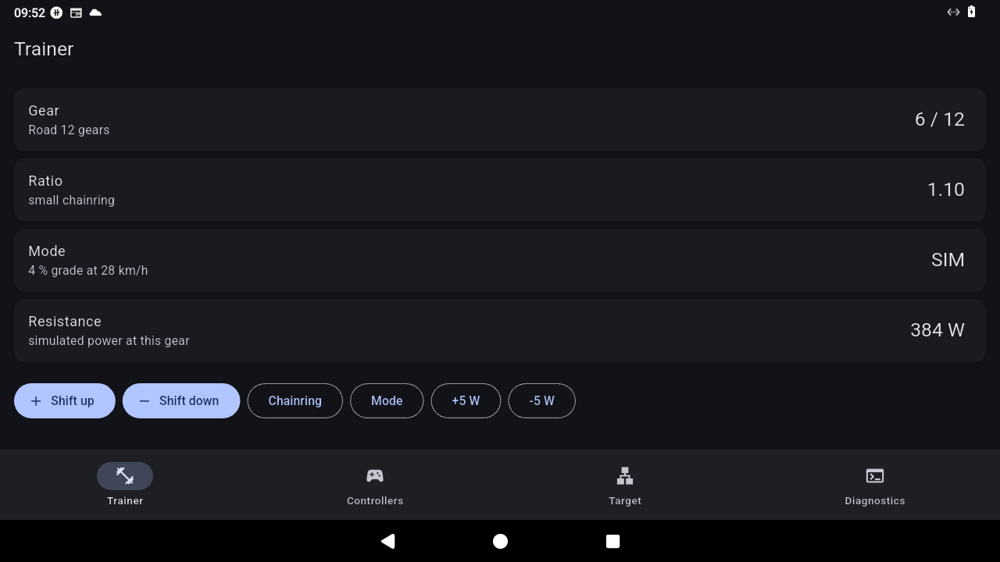
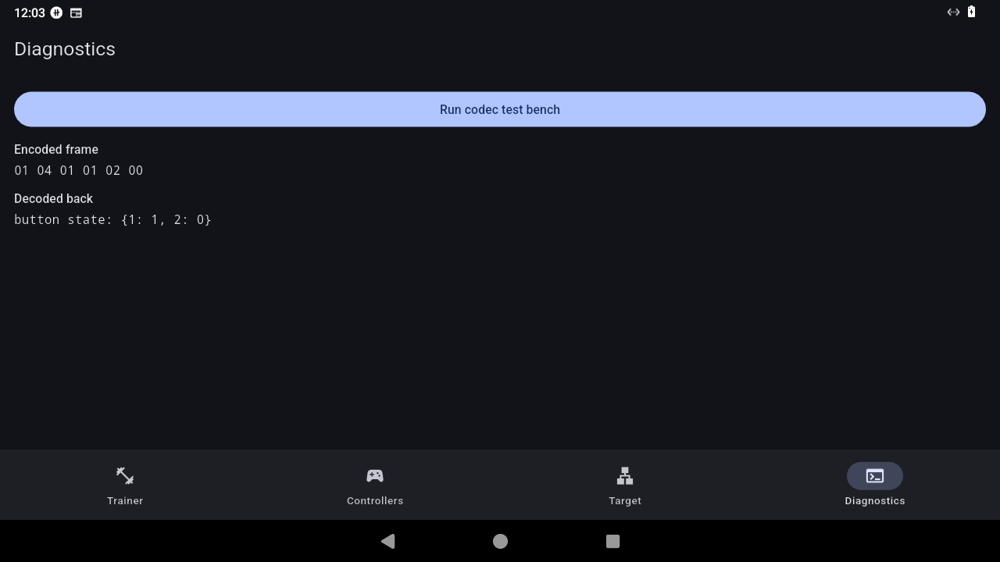
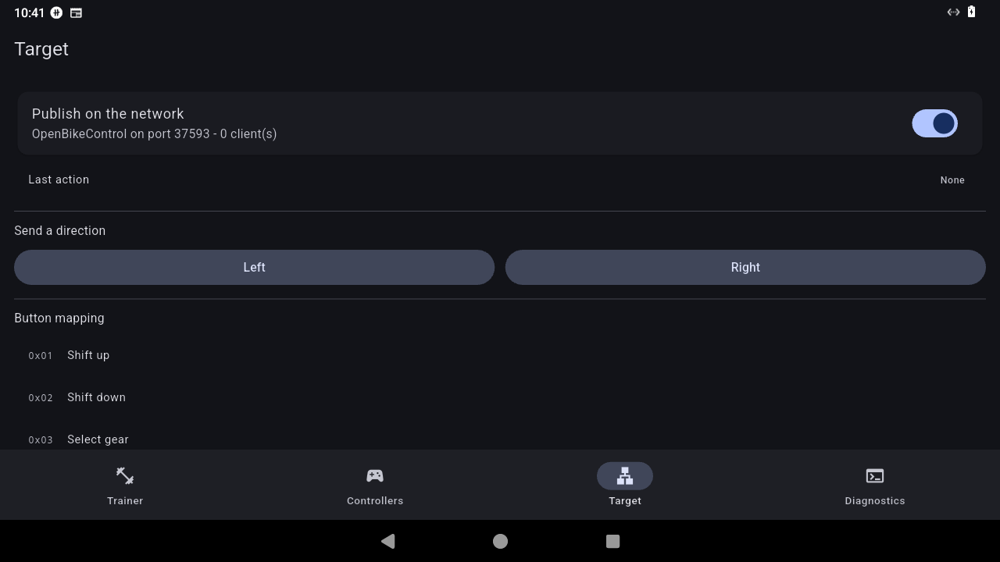
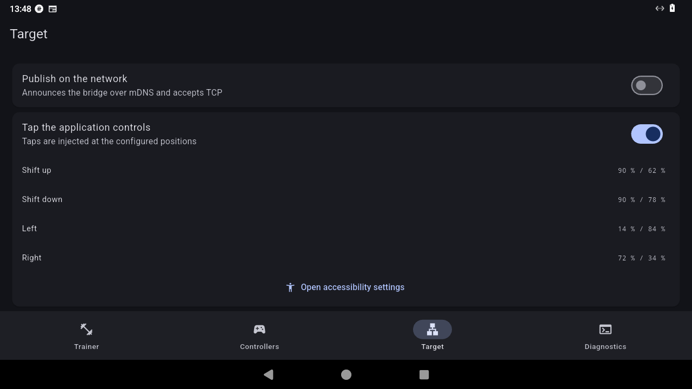

<div align="center">

# openzclick

**Use your indoor cycling controller buttons with any training app.**<br>
Gears go up and down, intersection directions get chosen, the smart trainer follows.

[](https://github.com/Atlanwhite147/openzclick/actions/workflows/ci.yml)
[](https://github.com/Atlanwhite147/openzclick/actions/workflows/android.yml)
[](https://github.com/Atlanwhite147/openzclick/actions/workflows/ios.yml)
[](https://github.com/Atlanwhite147/openzclick/actions/workflows/windows.yml)
[](https://github.com/Atlanwhite147/openzclick/actions/workflows/web.yml)
[](LICENSE)
[](#download)
[](#status)

</div>

---

A two-button controller bought for one application usually stops working as soon as you change application. openzclick reads the controller over Bluetooth, turns its button presses into gear changes, and publishes them on the local network with an open protocol, so the same buttons drive every training application that speaks it.

No account, no subscription, no telemetry. One Dart codebase for Android, iOS, Windows and macOS.

<div align="center">

| Trainer | Controllers | Diagnostics | Publishing |
|---|---|---|---|
|  |  |  |  |

</div>

## Features

| | |
|---|---|
| **Gears from two buttons** | single tap shifts up or down, from a gear profile (12-speed road, 8-speed flat, 24-speed hill) |
| **Intersection choices** | double tap sends a left or right direction without leaving the hoods |
| **Encrypted controller sessions** | ECDH P-256 handshake, HKDF-SHA256 derivation, AES-CCM frames, with a plain fallback for older firmware |
| **Open publication** | mDNS/DNS-SD announcement plus a TCP server, both in pure Dart, identical on every platform |
| **Tap fallback** | for applications that never speak the protocol, an Android accessibility service taps their own on-screen controls if needed |
| **Keyboard fallback** | on a Linux desktop, X11 and XTest turn button presses into real key presses, verified against a live X server |
| **Becomes the trainer** | FTMS decoded and encoded in pure Dart: the bridge can drive the real machine and impersonate a trainer, which is the only route that works on iPhone |
| **Works without hardware** | the whole protocol is unit tested; a command line probe checks the network link |
| **Settings that survive a restart** | gear profile, current gear, tap positions and publishers resume where you left them |
| **Honest diagnostics** | live controller state, battery level, codec test bench inside the application |

## Download

| Platform | File | Notes |
|---|---|---|
| Web | [atlanwhite147.github.io/openzclick](https://atlanwhite147.github.io/openzclick/) | nothing to install: Chrome or Edge, the controller pairs over Web Bluetooth |
| Android | [`app-release.apk`](https://github.com/Atlanwhite147/openzclick/releases/download/latest/app-release.apk) | sideload directly, updates install over the previous version |
| iOS | [`openzclick-unsigned.ipa`](https://github.com/Atlanwhite147/openzclick/releases/download/latest/openzclick-unsigned.ipa) | sign with Sideloadly or AltStore, 7 days with a free Apple ID |
| Windows | [`openzclick-windows-x64.zip`](https://github.com/Atlanwhite147/openzclick/releases/download/latest/openzclick-windows-x64.zip) | unzip and run `openzclick.exe` |

Every file is rebuilt on every push to `main`. The Android package is signed with the repository community key (`app/android/keystore/openzclick-test.jks`, password `openzclick`), which is public by design and must never be used for a store release.

## Getting started

```bash
git clone https://github.com/Atlanwhite147/openzclick.git
cd openzclick

# protocol and transports
cd core && dart pub get && dart test
cd ../transports && dart pub get && dart test

# application
cd ../app && flutter pub get
flutter run -d linux      # or windows, macos, android, ios, chrome
```

Requirements: Flutter stable (Dart 3.13 or newer). No Android SDK or Xcode needed for the protocol work.

## Architecture

<div align="center">


</div>

```
openzclick/
├─ core/          # pure Dart, no I/O: codec, session, gear engine, mapping, gestures
├─ transports/    # dart:io: mDNS responder, TCP server, Bluetooth/injection/proxy interfaces
├─ app/           # Flutter shell: pairing, gears, publishing, diagnostics; android, ios, windows, macos, web
├─ docs/          # specification, architecture notes, screenshots
└─ CONTRACTS.md   # interface signatures between the modules
```

Three rules keep the code portable:

1. **The core never performs I/O.** Everything can be tested without Bluetooth or a network.
2. **One output, one transport.** Implementations are wired at runtime, never selected by platform conditionals.
3. **No brand logic in the core.** Devices are described by declarative definition files.

## On iPhone today

iOS differs from the other platforms in two ways, and only one is a matter of code.

| Capability | On iOS |
|---|---|
| Pairing the controller, gears, gestures, diagnostics | works |
| Tap injection into another application | impossible: iOS exposes no equivalent of the Android accessibility service |
| mDNS announcement | blocked until Apple grants the multicast entitlement (`docs/ios-multicast.md`) |
| TCP server on the local network | works, after the local network permission prompt |

So the bridge follows the two rules without pretending: it always listens, and when it cannot announce itself it displays the address to type into the application (`192.168.1.24:47123`). Applications that only discover services need the entitlement, or a bridge running on the machine where they run.

## In a browser

The same code runs in a tab, with nothing to install: the published page, or `flutter run -d chrome` from a checkout. It is honest about what a page is allowed to do.

| Capability | In a browser |
|---|---|
| Pairing the controller, gears, gestures, diagnostics | works, through Web Bluetooth (Chrome, Edge, Chrome for Android; Safari and Firefox expose no Web Bluetooth) |
| Driving a bridge running on the local network | works: the page is the console of the bridge, over a WebSocket, and a QR code on the bridge opens it already connected (`docs/console.md`) |
| mDNS announcement, TCP server | works when the page is an **Isolated Web App**: Chrome then grants Direct Sockets, and the page becomes the bridge itself (`docs/browser-bridge.md`) |
| Tap or keyboard injection | impossible: a page cannot synthesise input for another application |
| Becoming the trainer | impossible: browsers only offer the central role of Bluetooth, never the peripheral one |

Web Bluetooth is only exposed to a secure context, so the page must be served over HTTPS or from `localhost`. The publication card states this instead of pretending: for a training application to see the buttons, either the page runs as an Isolated Web App on that machine, or the bridge runs elsewhere on the local network and the page enters the address and the four letter code it displays.

### The page as the bridge

An Isolated Web App is a signed bundle Chrome installs; it is the only context where a page is allowed a TCP server. There the page announces `_openbikecontrol._tcp` over mDNS and serves the protocol on 47123, so a training application discovers it as it discovers the desktop build. Verified on Chrome 145: an announcement left the page, a client connected, and a shift arrived as button `0x01` pressed then released.

The two limits are the platform's, not the code's: a page may send to a multicast group but not bind to it, so queries are never answered and the announcement is repeated every two seconds; and nothing on iOS or Android grants Direct Sockets, so on a phone the page stays a console. `docs/browser-bridge.md` has the build, signing and install steps.

## When the application only accepts taps

Some applications expose no protocol and no keyboard shortcut: the only way to change gear is to press their on-screen button. The bridge then turns an action into a tap at a position you configure once, expressed in percentages so it survives a change of screen.

1. Install the accessibility service from **Target → Open accessibility settings** (Android only, once).
2. Enable **Tap the application controls**, then give the position of each control: shift up, shift down, left, right.
3. Press a button on the controller, or use **Send a direction** to check the calibration.

Verified on Android 13: a request is dispatched as a real touch (`tap at 182,603 accepted=true` in the log) and the application reacts exactly as if a finger had touched the screen. Android only allows this through an accessibility service; no root, no shell command, and the service never reads the screen.

## Injection, when nothing else works

Applications that accept neither the network protocol nor a Bluetooth controller get driven directly: a tap on Android, a keystroke on a desktop.

| Host | Keyboard | Pointer | State |
|---|---|---|---|
| Linux, X11 | XTest | XTest | implemented and verified |
| Android | not allowed by the platform | accessibility service | implemented and verified |
| Windows, macOS | - | - | **open to a contributor** |
| iOS | - | - | impossible, the platform forbids synthetic input |

Details, default bindings and how to write the Windows or macOS port: [docs/injection.md](docs/injection.md).

## Becoming the trainer

Two applications never share a trainer, and iOS forbids synthetic input. So the bridge can take the machine, apply the resistance of the selected gear, and present itself to the training application as an ordinary FTMS trainer. The application then needs no virtual shifting at all.

The protocol layer is implemented and tested in pure Dart; the Bluetooth halves are the remaining work.

```
grade 4 %, gear 6   -> resistance 36.7 %  -> 07 25 written on the real trainer
shift up, gear 9    -> resistance 62.6 %  -> 07 3f
ergometer 240 W     -> forwarded unchanged -> 08 f0 00
```

Details and calibration caveats: [docs/trainer-proxy.md](docs/trainer-proxy.md).

## How the link works

**Controller side.** Scan for the controller service (`00000001-19ca-4651-86e5-fa29dcdd09d1`), subscribe to the asynchronous channel for buttons and to the synchronous reply channel, write the handshake to the write-only one (`docs/controllers.md` explains why swapping them gives a link that connects and stays silent), send an encrypted handshake carrying an ephemeral P-256 key with a plain `RideOn` fallback after three seconds. If the device answers with its public key, the session is derived with ECDH then HKDF-SHA256 and every frame is decrypted with AES-CCM; otherwise frames are parsed in the clear. Button notifications are protobuf varints.

**Training application side.** The bridge announces `openzclick._openbikecontrol._tcp.local` with the TXT record of the specification (`version`, `id`, `name`, `service-uuids`, `manufacturer`, `model`). A client connects over TCP, sends an application info frame, and receives one frame per action, with no length field on the wire: `01 01 01` for shift up pressed, `01 18 01` for a steer left. One write carries one message, which is what delimits frames in a protocol that has no length byte.

Check the publication without a phone:

```bash
cd transports && dart run tool/net_probe.dart 47123
```

Then browse `_openbikecontrol._tcp` with any mDNS browser and connect a client to the printed port.

Protocol facts are implemented in Dart from public interoperability notes; no third-party code is copied. Cryptographic primitives come from `pointycastle`.

## Status

| Module | State | Tests |
|---|---|---|
| `core/` | protocol, session, link supervision, gear engine, mapping, gestures | 225 |
| `transports/` | mDNS responder, TCP server, console relay, FTMS trainer proxy; Bluetooth stays an interface | 94 |
| `app/` | pairing, gears, publishing, console, injection, diagnostics on Android, iOS, Windows, macOS and the browser | 42 |

Verified on Android 13: installation, first frame, gear changes, direction choices, tap injection through the accessibility service, announcement visible from the local network and TCP handshake with a client. The browser build was checked in Chrome against its own build output: the four sections render, the gear engine runs, a click on **Shift up** reaches a headless bridge (`action shiftUp from console-1` in its log), and a gear changed on the bridge side moves the page without any click. The Bluetooth link cannot be exercised in the test container, which has no radio; see [CONTRIBUTING.md](CONTRIBUTING.md) if you own a controller and want to help close that gap.

## Roadmap

- [x] binary protocol, encrypted sessions, gear engine
- [x] two-button gestures, direction choices
- [x] network publication in the shared core
- [x] persisted settings and gear profile selection
- [x] continuous Android and iOS builds
- [x] local injection transport, with an Android accessibility service driver
- [ ] Bluetooth peripheral backend (advertise the bridge as a trainer)
- [ ] iPhone multicast entitlement
- [x] browser build: the same interface in a tab, the controller over Web Bluetooth, and the page as the console of a bridge on the local network
- [ ] browser, next: drive the trainer directly over FTMS, for the applications that do not handle shifting



The detailed roadmap, including what is open to a first contribution, lives in [docs/ROADMAP.md](docs/ROADMAP.md). The specification is in [docs/spec.md](docs/spec.md).

## Contributing

Issues and pull requests are welcome. Read [CONTRIBUTING.md](CONTRIBUTING.md) first: it explains the module boundaries, the test expectations and how to report a controller that does not pair.

## License

MIT, see [LICENSE](LICENSE).
